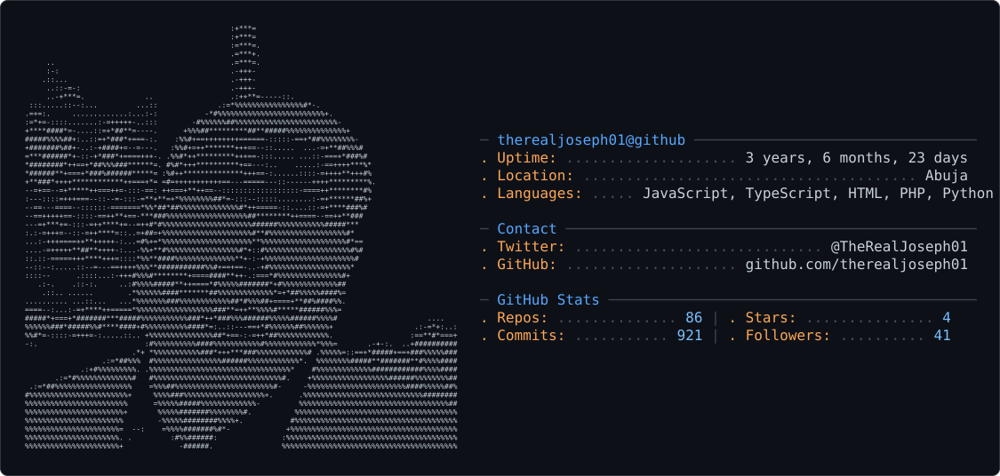

<picture>
  <source media="(prefers-color-scheme: dark)" srcset="dark_mode.svg" />
  <source media="(prefers-color-scheme: light)" srcset="light_mode.svg" />
  
</picture>

<h3 align="center">
  I build apps fast enough to impress clients 
  and bugs fast enough to humble myself.
</h3>

###

  

  
  

  

  

###

  
  
  
  

###

###
